

  

  &nbsp;

  &nbsp;

---

### 🧑‍💻 Hakkımda

- 📱 Android ve iOS için **mobil uygulamalar ve oyunlar** geliştiriyorum
- 🚀 **PLTApps** adıyla Google Play'de 13, App Store'da 3 uygulamam yayında
- 📍 İstanbul

 

### 📱 Yayındaki uygulamalarım

  

  <a href="https://play.google.com/store/apps/details?id=com.adempolat.leaguesimulation">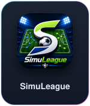</a>
  <a href="https://play.google.com/store/apps/details?id=com.adempolat.kpsshistory">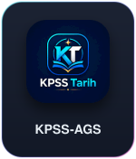</a>
  <a href="https://play.google.com/store/apps/details?id=com.adempolat.watersortgame">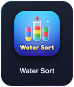</a>
  <a href="https://play.google.com/store/apps/details?id=com.adempolat.okey101">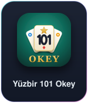</a>
   <a href="https://play.google.com/store/apps/details?id=com.adempolat.wordlymaster">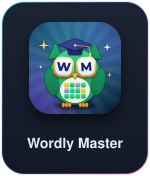</a>
  <a href="https://play.google.com/store/apps/details?id=com.adempolat.kelime">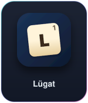</a>
  <a href="https://play.google.com/store/apps/details?id=com.adempolat.wordpuzzle">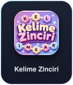</a>
  <a href="https://play.google.com/store/apps/details?id=com.codecorp.tycoon">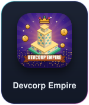</a>
   <a href="https://play.google.com/store/apps/details?id=com.adempolat.battleshipcompose">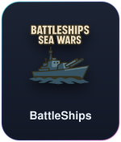</a>
  <a href="https://play.google.com/store/apps/details?id=com.adempolat.dropmerge">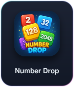</a>
  <a href="https://play.google.com/store/apps/details?id=com.adempolat.circlematch">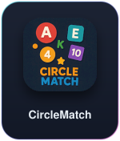</a>
  <a href="https://play.google.com/store/apps/details?id=tr.cerkes.klavye">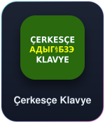</a>

  

  
  
  

### 🛠️ Kullandıklarım

  

### 📈 Aktivite

  

